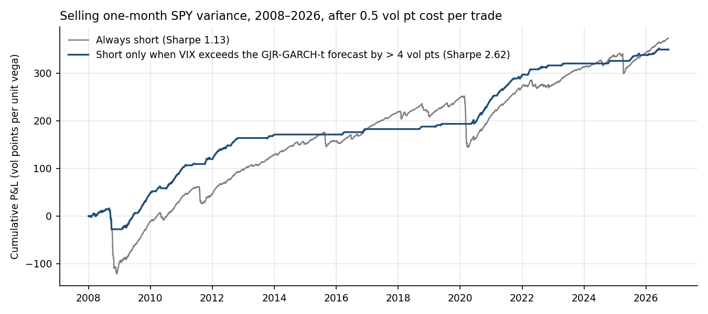
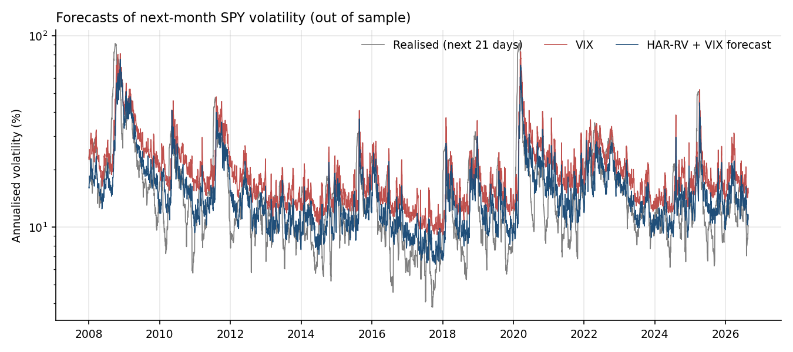
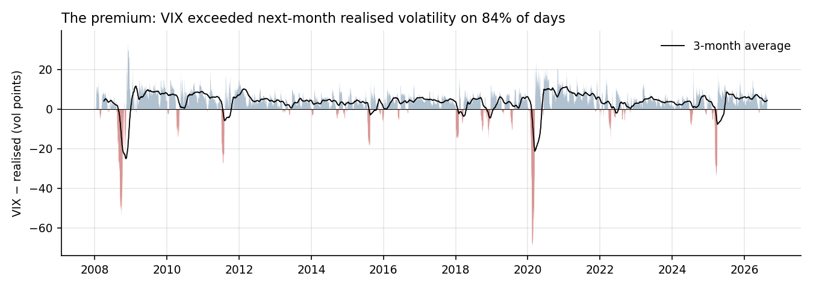
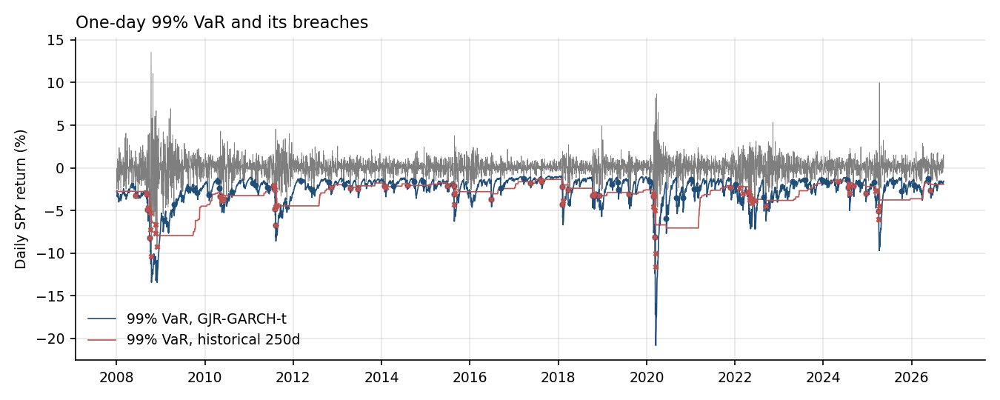
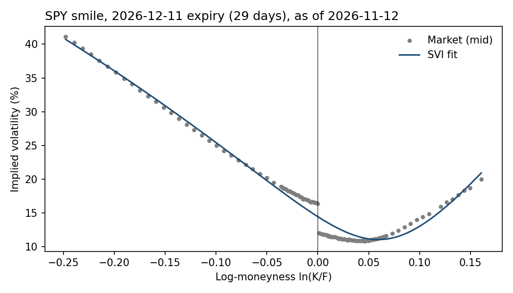

# Volatility Risk Premium: forecasting, trading and risk

**HAR-RV · GARCH / GJR-GARCH · LSTM · Walk-forward evaluation · Variance-swap backtest · Deflated Sharpe · VaR/ES backtesting · Black–Scholes & SVI**

Option sellers earn a premium because implied volatility usually exceeds the volatility that follows. On SPY from 2008 to 2026, VIX was above the next month's realised volatility on **84% of days**, by **3.7 vol points** on average. The premium is not free money: it collapses in a crash, and those few months decide whether selling volatility pays.

This project asks three questions:

1. **Forecasting.** Can a statistical forecast of next month's volatility beat VIX?
2. **Trading.** Does selling volatility *only when it looks expensive* improve risk-adjusted returns after costs?
3. **Risk.** How much can the position lose in a day, and do standard VaR models hold up?
4. **Options.** What does the option market price today, strike by strike?



## Results

Out of sample, walk-forward, **Jan 2008 – Sep 2026** (4,689 forecast days, 225 monthly roll dates). Every model is refitted on an expanding window and uses only data available at the close of the day it forecasts from.

### 1. Forecasts of next-month (21-day) SPY volatility

| Forecast | RMSE (vol pts) | QLIKE | Bias (vol pts) | MZ R² | Beats VIX on QLIKE? (DM p) |
|---|---|---|---|---|---|
| Naive (last 21 days) | 9.58 | 0.58 | +0.0 | 0.41 | No, worse (p < 0.01) |
| **VIX (implied)** | 8.93 | **0.38** | **+3.7** | **0.49** | benchmark |
| HAR-RV | 8.27 | 0.45 | −1.0 | 0.48 | No (p = 0.27) |
| **HAR-RV + VIX** | **8.15** | 0.41 | −0.5 | **0.49** | No (p = 0.59) |
| GARCH(1,1)-t | 8.91 | 0.38 | +1.4 | 0.45 | No (p = 0.78) |
| GJR-GARCH-t | 8.41 | 0.39 | +0.6 | 0.48 | No (p = 0.72) |
| LSTM | 9.16 | 0.47 | −0.7 | 0.35 | No (p = 0.16) |

- **No model beats VIX outright.** HAR-RV + VIX has the lowest squared error. On QLIKE, the loss that best ranks volatility forecasts, VIX is as good as any model.
- **VIX is biased by the premium itself.** It overstates realised volatility by 3.7 points on average, so it is a good forecast of *risk* and a poor forecast of the *level*.
- **The time-series models still add information.** Regressing realised volatility on VIX together with each forecast (HAC t-stats), HAR-RV (t = 3.3) and GJR-GARCH (t = 2.9) stay significant alongside VIX. The LSTM does not (t = −0.2): with about 280 non-overlapping months of history, a neural network finds nothing that HAR doesn't already capture.



### 2. Selling one-month variance on SPY

Each strategy sells a 21-day variance swap struck at VIX every 21 trading days, or stays flat. P&L is in vol points per unit of vega, after **0.5 vol points of cost per trade**. 10 variants were tested: always short, plus "short only when VIX exceeds the forecast by more than 0 / 2 / 4 vol points" for HAR, HAR + VIX and GJR-GARCH.

| Strategy | Sharpe | Median Sharpe, 21 roll start days | Max drawdown | Worst month | Months invested | Months won |
|---|---|---|---|---|---|---|
| Always short | 1.13 | 0.97 (0.38 to 1.31) | −139 | −85 (Oct 2008) | 100% | 81% |
| Short if VIX > HAR + VIX forecast + 4 pts | 0.65 | 1.09 (0.50 to 1.94) | −128 | −85 | 46% | 81% |
| Short if VIX > GJR-GARCH forecast | 2.58 | 1.81 (0.34 to 2.79) | −43 | −42 | 87% | 83% |
| **Short if VIX > GJR-GARCH forecast + 4 pts** | **2.62** | **2.62 (1.84 to 3.57)** | **−43** | **−42** | 36% | 91% |

- **The GARCH filter halves volatility and cuts the drawdown by two-thirds** for about the same total P&L (350 vs 373 vol points). GARCH reacts within days to a volatility shock, so it stops selling volatility after a market starts to break. VIX moves too, but more slowly.
- **The HAR filters barely help.** HAR's monthly component lags, so it rarely flags danger in time.
- **Robustness to the start date.** A monthly roll can be lucky: the plain GARCH filter missed the February 2020 roll by 0.1 vol points and so avoided the COVID crash. Rerunning each rule from all 21 possible roll days gives the median and range in the table. The +4-point rule's Sharpe never falls below 1.84, but always-short's ranges from 0.38 to 1.31.
- **Selection bias.** After 10 trials, the **deflated Sharpe ratio** of the best variant is **0.90**: a 90% probability that its true Sharpe exceeds what the luckiest of 10 random strategies would show. That is promising, but below the usual 95% bar.
- **Short volatility stays short volatility.** Monthly returns are heavily left-skewed for every variant (skew between −3.7 and −6.0).



### 3. One-day 99% VaR on SPY

| Model | Breaches (expected 47) | Kupiec p | Breaches clustered? (Christoffersen p) | Avg loss on breach vs avg ES |
|---|---|---|---|---|
| Historical simulation, 250 days | 74 | < 0.01 | **Yes** (p < 0.01): 11% chance of a breach the day after a breach | 3.9% vs 2.8% |
| GJR-GARCH-t | 76 | < 0.01 | **No** (p = 0.51) | 2.7% vs 2.1% |

Both models breach too often. Historical simulation fails the way regulators worry about: breaches arrive in clusters (12 in 2008, 10 in 2022) because a 250-day window adapts slowly. GJR-GARCH fixes the clustering but its Student-t tails are too thin for SPY's left tail. The next step is filtered historical simulation, or a skewed-t distribution.



### 4. What options price today: the SPY smile

Snapshot of **12 Nov 2026**, 11 Dec 2026 expiry (29 days), 123 out-of-the-money quotes, fitted with an arbitrage-checked raw SVI curve (`scripts/fetch_option_chain.py`).

| Measure | Value |
|---|---|
| At-the-money implied volatility | **14.4%** |
| Implied vol at the 95% strike / 105% strike | 19.9% / 11.2% |
| Skew (95% minus 105% strike) | **8.8 vol points** |
| Fit error (average) | about 1 vol point |
| No-arbitrage checks | minimum total variance ≥ 0, Lee wing bound met |

Downside puts cost far more volatility than upside calls: the market charges most for the crash risk that drives the strategy's worst months. At-the-money implied volatility (14.4%) sits close to VIX on the last day of the study sample (14.2%, 22 Sep 2026), and above the HAR-RV (10.1%) and GJR-GARCH (11.2%) forecasts on that day, a premium of about 3–4 vol points, in line with its long-run average.



## Method

| Step | Detail | Code |
|---|---|---|
| Data | SPY daily OHLC and adjusted close (Yahoo Finance), VIX close (Cboe), Feb 2003 – Sep 2026 (see `data/README.md`) | `src/vrp/data.py` |
| Target | Realised volatility over days t+1 … t+21 from close-to-close returns: the window a 30-calendar-day VIX quote prices | `features.py` |
| Features | Garman–Klass range-based variance for the HAR day/week/month components (variances averaged before the square root) | `features.py` |
| HAR-RV | Corsi (2009), log-volatility regression with log-normal bias correction, refitted every 21 days | `models.py` |
| GARCH | GARCH(1,1) and GJR-GARCH(1,1,1), Student-t errors, `arch` package, refitted every 21 days | `models.py` |
| LSTM | 32-unit LSTM on 22-day sequences, refitted every January, early stopping on the last 15% of the window | `models.py` |
| Leakage control | A training row is used only once its 21-day target has ended; a unit test checks that no feature sees the future | `tests/` |
| Evaluation | RMSE, QLIKE, Mincer–Zarnowitz, Diebold–Mariano and encompassing regressions, all with Newey–West (21-lag) errors | `evaluate.py` |
| Strategy | Variance-swap payoff (K² − RV²)/2K accrued daily on the realised leg; deflated Sharpe (Bailey & López de Prado, 2014) | `backtest.py` |
| Risk | GJR-GARCH-t and historical-simulation VaR/ES; Kupiec and Christoffersen tests | `risk.py` |
| Options | Black–Scholes price and Greeks, implied volatility (Brent), raw SVI smile fit | `options.py` |

## Run it

```bash
pip install -e ".[dev,lstm]"
python scripts/run_all.py          # ~3 minutes: writes reports/results.json, reports/tables.md, reports/figures/
python scripts/run_all.py --fast   # without the LSTM (what CI runs)
pytest -q
```

The data is committed under `data/raw/` so results reproduce offline. `python -c "from vrp import data; data.refresh()"` downloads newer data.

```
src/vrp/      data · features · models · evaluate · backtest · risk · options
scripts/      run_all.py (whole study) · fetch_option_chain.py (SPY chain snapshot for the SVI fit)
tests/        look-ahead, estimator, Black–Scholes, SVI, Kupiec and payoff tests
reports/      results.json, tables.md, figures/
notebooks/    archive/ holds the original exploratory notebooks
```

## Limitations

- **The P&L is a variance-swap proxy.** It accrues the realised leg daily and ignores mark-to-market moves in implied volatility before expiry, which deepen drawdowns in a crash. VIX is used as the strike, so the strike is not a tradeable quote.
- **The costs are an assumption.** 0.5 vol points per trade is a flat estimate; real costs widen sharply in markets like 2008 and 2020.
- **The sample is one asset over one long bull market.** The next steps are other indices, and power and gas implied volatility.
- **Out-of-sample VaR fails coverage.** See section 3.

## Author

Josephine Amponsah Baah · Data scientist, risk modelling · FRM candidate · [LinkedIn](https://www.linkedin.com/in/josephine-amponsah-baah)
